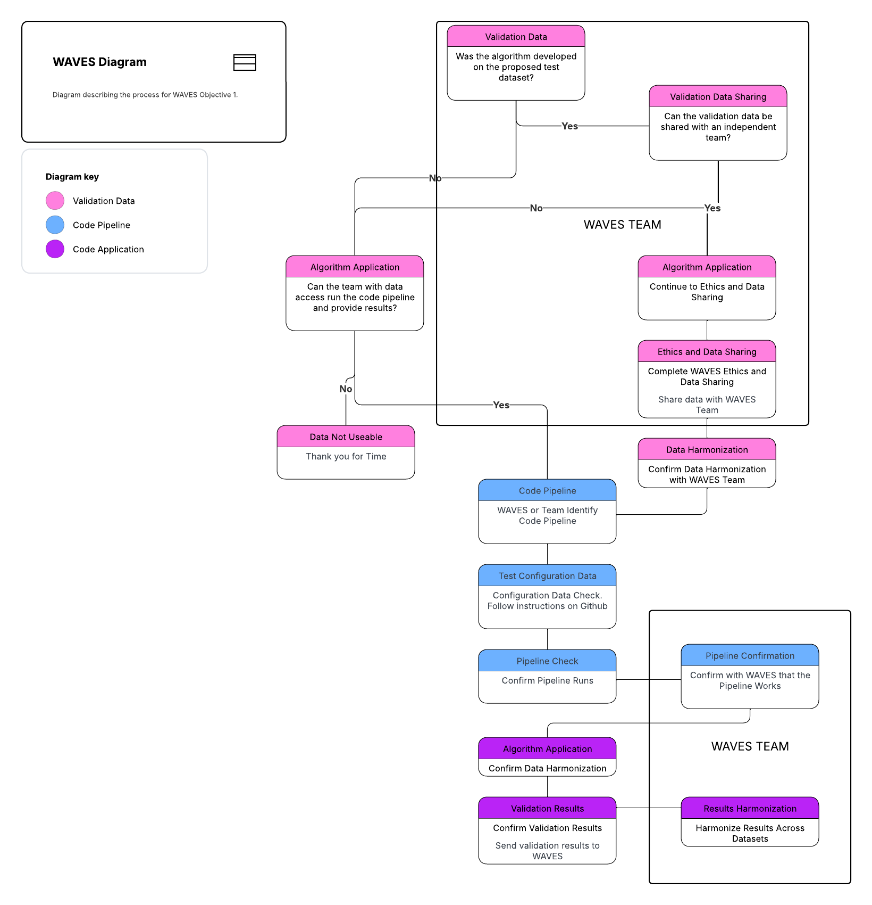

<!-- README.md is generated from README.Rmd. Please edit that file -->

```{r, include = FALSE}
knitr::opts_chunk$set(
  collapse = TRUE,
  comment = "#>",
  fig.path = "man/figures/README-",
  out.width = "100%"
)
```

# Youth WAVES

Thank you for your collaboration in Youth WAVES, the youth (children and adolescents) arm of the Wrist Algorithm Verification and Evaluation Study (WAVES). This branch of the repository contains all the code needed to run multiple youth-specific wrist algorithms against your raw data.

## Proposed Flow Diagram

The proposed flow diagram outlines the process for how the validation data and data pipeline will work with the WAVES team and groups who have potentially available validation data.



**Full description of the flow diagram coming soon**

## Getting Started

Visit the [Github Pages for WAVES](https://waves-collaborative.github.io/WAVES/) and click on the "Get Started" tab.

FIGURE showing the "Get Started" page

## Methods Implemented

| Method | MVPA | SED | Steps |
|------------------|------------------|------------------|------------------|
| Trost/Chowdhury 2017[@chowdhury2017] Random Forest (school-age wrist classifier) | ✔️ | ✔️ | ❌ |
| Trost 2014[@trost2014] Regularised Logistic Regression | ✔️ | ✔️ | ❌ |
| Hildebrand 2014[@hildebrand2014]/2017[@hildebrand2017] | ✔️ | ✔️ | ❌ |

## TODO

- Pilot test the Youth WAVES pipeline with the youth algorithms.

  - Trost/Chowdhury 2017 Random Forest
  - Trost 2014 Regularised Logistic Regression
  - Hildebrand 2014/2017 cut-points

## References for Methods
