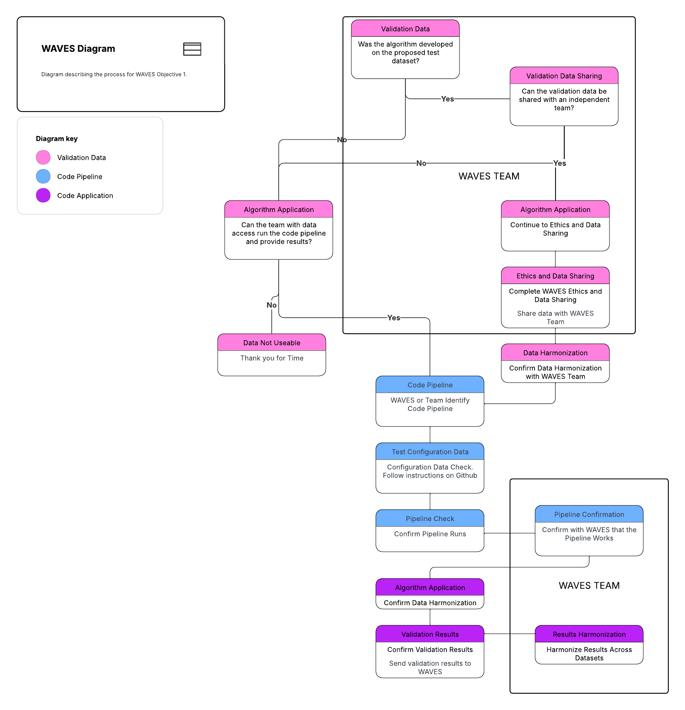

<!-- README.md is generated from README.Rmd. Please edit that file -->

# Youth WAVES

Thank you for your collaboration in Youth WAVES, the youth (children and
adolescents) arm of the Wrist Algorithm Verification and Evaluation
Study (WAVES). This branch of the repository contains all the code
needed to run multiple youth-specific wrist algorithms against your raw
data.

## Proposed Flow Diagram

The proposed flow diagram outlines the process for how the validation
data and data pipeline will work with the WAVES team and groups who have
potentially available validation data.

<figure>

<figcaption aria-hidden="true">Flow Diagram</figcaption>
</figure>

**Full description of the flow diagram coming soon**

## Getting Started

Visit the [Github Pages for
WAVES](https://waves-collaborative.github.io/WAVES/) and click on the
“Get Started” tab.

FIGURE showing the “Get Started” page

## Methods Implemented

| Method                                                                 | MVPA | SED | Steps |
|------------------------------------------------------------------------|------|-----|-------|
| Trost/Chowdhury 20171 Random Forest (school-age wrist classifier) | ✔️   | ✔️  | ❌    |
| Trost 20142 Regularised Logistic Regression                 | ✔️   | ✔️  | ❌    |
| Hildebrand 20143/20174                           | ✔️   | ✔️  | ❌    |

## TODO

- Pilot test the Youth WAVES pipeline with the youth algorithms.

  - Trost/Chowdhury 2017 Random Forest
  - Trost 2014 Regularised Logistic Regression
  - Hildebrand 2014/2017 cut-points

## References for Methods

1.
Chowdhury AK, Tjondronegoro D,
Chandran V, et al. [Ensemble methods for classification of physical
activities from wrist
accelerometry](https://doi.org/10.1249/MSS.0000000000001291). *Medicine
& Science in Sports & Exercise* 2017; 49: 1965–1973.

2.
Trost SG, Zheng Y, Wong W-K.
[Machine learning for activity recognition: Hip versus wrist
data](https://doi.org/10.1088/0967-3334/35/11/2183). *Physiological
Measurement* 2014; 35: 2183–2189.

3.
Hildebrand M, Van Hees VT, Hansen
BH, et al. [Age group comparability of raw accelerometer output from
wrist- and hip-worn
monitors](https://doi.org/10.1249/MSS.0000000000000289). *Medicine &
Science in Sports & Exercise* 2014; 46: 1816.

4.
Hildebrand M, Hansen BH, Hees VT
van, et al. [Evaluation of raw acceleration sedentary thresholds in
children and adults](https://doi.org/10.1111/sms.12795). *Scandinavian
Journal of Medicine & Science in Sports* 2017; 27: 1814–1823.

